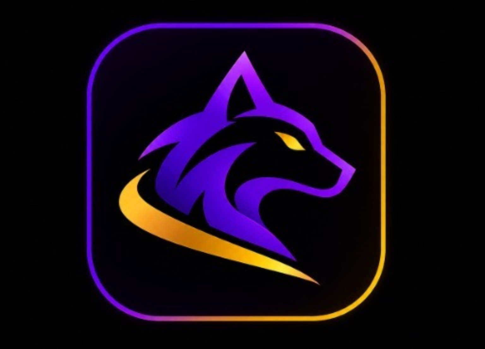

<p align="center">
  
</p>

<h1 align="center">act Work&Up</h1>

<h3 align="center">Conectando talentos. Aproximando oportunidades.</h3>

<p align="center">
  Um marketplace de serviços presenciais e digitais em um único ambiente.
</p>

---

## Sobre o projeto

O **act Work&Up** é uma plataforma web desenvolvida com o objetivo de conectar pessoas que precisam contratar serviços a profissionais autônomos e empresas que desejam divulgar seu trabalho.

A proposta é centralizar diferentes modalidades de serviços em um único ambiente, proporcionando uma experiência simples, acessível e organizada tanto para quem contrata quanto para quem oferece.

Com foco inicial em Indaiatuba e região, a plataforma busca facilitar a descoberta de profissionais, a comparação de serviços e a comunicação entre clientes e prestadores.

## Objetivos

- Facilitar o acesso a profissionais e empresas prestadoras de serviços.
- Reunir serviços presenciais e digitais em uma única plataforma.
- Oferecer um ambiente de divulgação para profissionais autônomos e empresas.
- Simplificar a busca, comparação e contratação de serviços.
- Promover mais transparência na comunicação entre clientes e prestadores.

## Funcionalidades

### Para usuários

- Cadastro e acesso à plataforma.
- Exploração e pesquisa de serviços.
- Filtros por categoria e modalidade de atendimento.
- Visualização de perfis profissionais.
- Consulta de avaliações e informações dos serviços.
- Central de mensagens.
- Acompanhamento de pedidos.
- Simulação de pagamento via Pix.

### Para profissionais autônomos

- Cadastro como prestador de serviços.
- Divulgação de serviços.
- Apresentação de informações profissionais.
- Gerenciamento de serviços anunciados.
- Comunicação com potenciais clientes.

### Para empresas

- Cadastro empresarial.
- Registro de informações comerciais.
- Participação no marketplace como prestadora de serviços.

## Diferenciais do projeto

- **Serviços presenciais e digitais:** conecta profissionais de diferentes áreas em um único ambiente.
- **Pagamento mais seguro:** o valor fica retido até a conclusão do serviço.
- **Comunicação integrada:** permite que clientes e profissionais conversem diretamente pela plataforma.
- **Perfis e portfólios:** facilitam a análise, a avaliação e a escolha dos profissionais.
- **Praticidade:** reúne busca, contratação e acompanhamento dos serviços em um só lugar.

## Tecnologias utilizadas

| Tecnologia | Aplicação |
|---|---|
| HTML5 | Estrutura das páginas |
| CSS3 | Estilização e responsividade |
| JavaScript | Funcionalidades e interações |

## Identidade visual

A interface utiliza uma identidade visual própria, com foco em uma experiência moderna, organizada e intuitiva.

- **Roxo:** `#5101D4`
- **Roxo escuro:** `#39009B`
- **Amarelo:** `#E39F21`
- **Fundo:** `#F7F6FA`

**Tipografia:**

- DM Sans — textos e elementos da interface.
- Fraunces — títulos e destaques.

## Estrutura do projeto

```text
act-work-up/
│
├── assets/
│   └── logo-wolfservices.jpg
│
├── index.html
├── inicio.html
├── explorar.html
├── login.html
├── cadastro-tipo.html
├── cadastro-pessoal.html
├── cadastro-empresa.html
├── perfil.html
├── meus-servicos.html
├── mensagens.html
├── pagamento.html
│
├── style.css
└── script.js
```

## Como executar o projeto

1. Faça o download ou clone este repositório.
2. Abra a pasta do projeto no Visual Studio Code.
3. Execute o arquivo `inicio.html` utilizando a extensão Live Server.
4. A plataforma será aberta no navegador.

## Observação

O projeto possui funcionalidades demonstrativas. O cadastro, o login e o fluxo de pagamento são simulações para fins de apresentação e desenvolvimento acadêmico.

---

<p align="center">
  Desenvolvido como projeto acadêmico.
</p>
